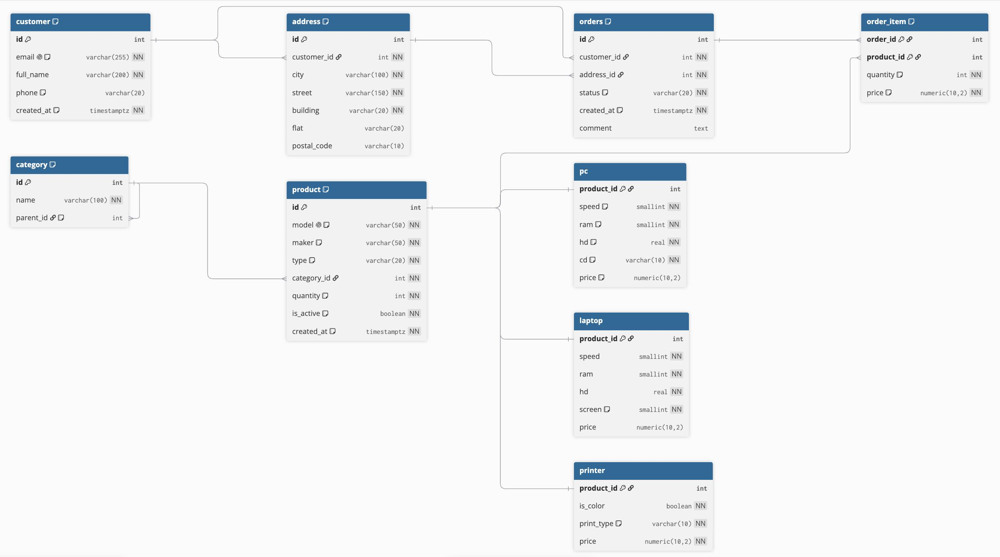
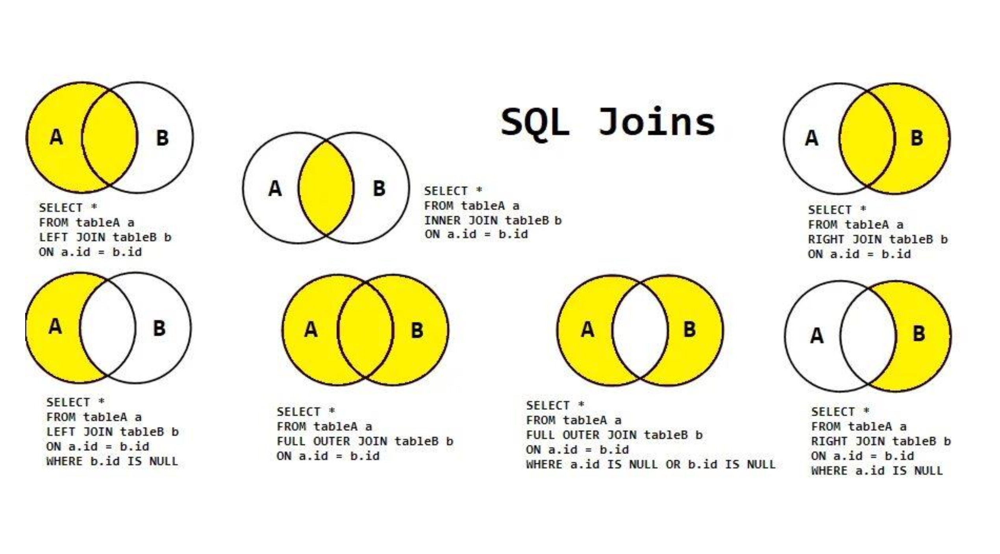

| Оператор | Что делает | Направление | Результат |
|---|---|---|---|
| `JOIN` | Соединяет таблицы по **горизонтали** | Добавляет **столбцы** | Строки сопоставляются по условию `ON` |
| `UNION` | Соединяет таблицы по **вертикали** | Добавляет **строки** | Объединяет результаты двух `SELECT` |
| `INTERSECT` | Находит строки, присутствующие в **обоих** наборах | Пересечение | Только общие строки |
| `EXCEPT` | Возвращает строки, которые есть в **первом** `SELECT`, но отсутствуют во **втором** | Разность | Строки только из первого набора |

``` sql
-- Нужны города клиентов, куда не доставляли заказы
SELECT city FROM address                 -- выбираем все города
    EXCEPT                               -- можно сказать что это знак `-`
SELECT a.city FROM address AS a          -- выбираем города, которые есть в заказах
JOIN orders o ON o.address_id = a.id;
```

``` sql
-- Нужны производители которые делают и ПК и Принтера
SELECT maker FROM product WHERE type = 'PC'         -- выбираем всех кто делает ПК
    INTERSECT                                       -- можно сказать что это знак '+'
SELECT maker FROM product WHERE type = 'Printer'    -- выбираем всех кто делает Принетры
ORDER BY 1;
```