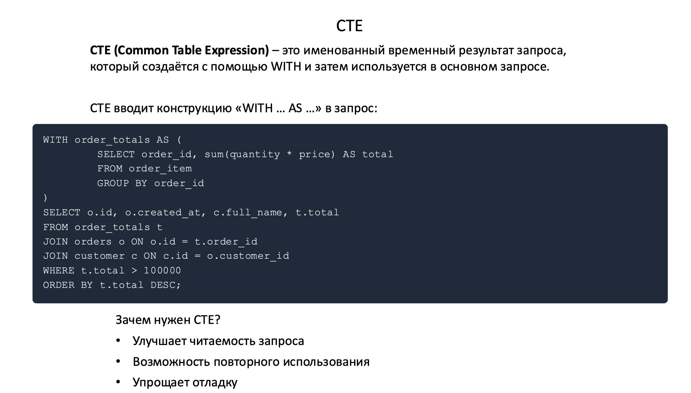
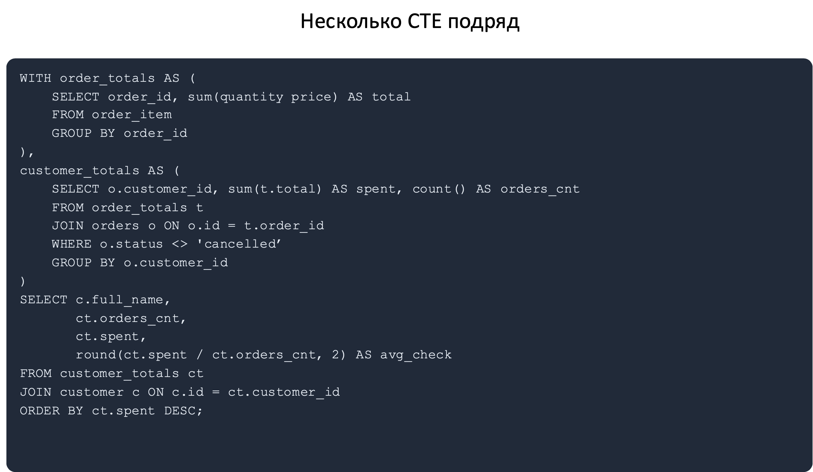
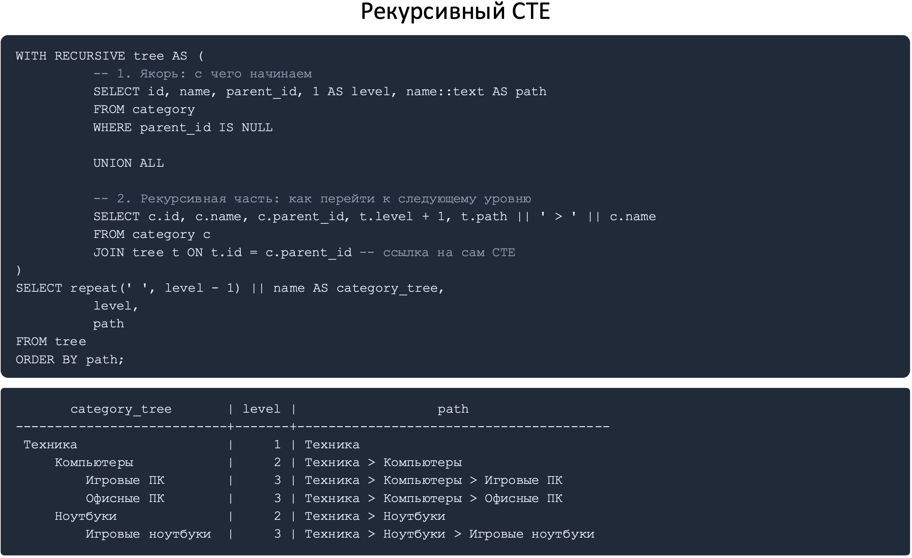
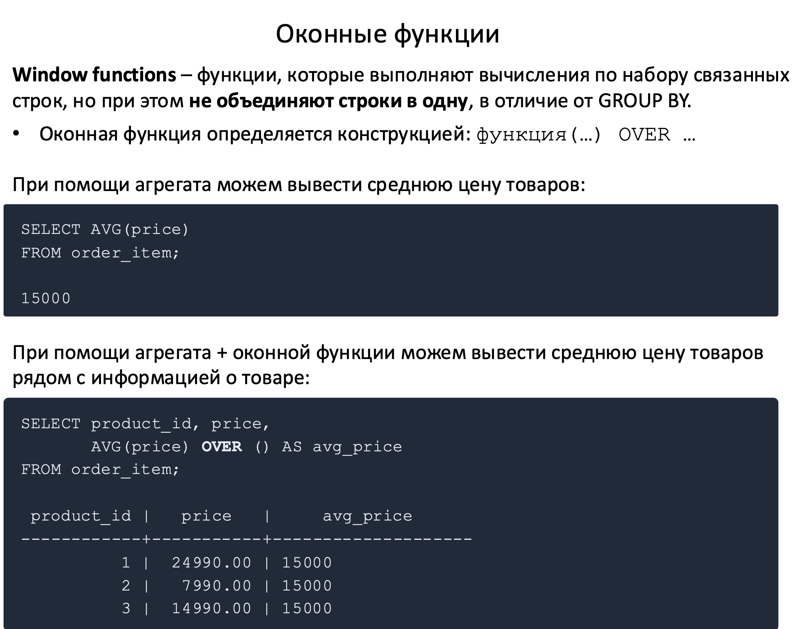
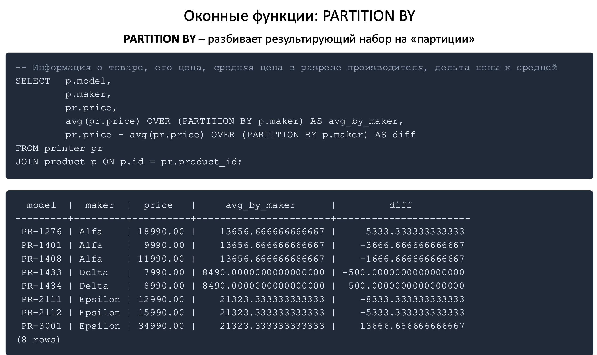
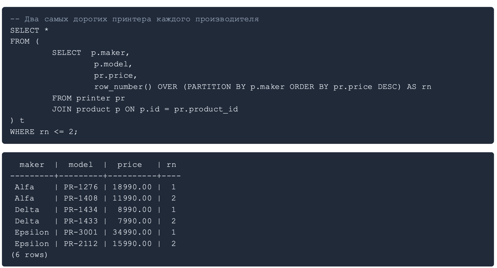

### Агрегатная функция
Функция, которая берёт несколько строк и превращает их в одно значение.

| Функция | Что делает |
| :--- | :--- |
| `count(*)` | число строк |
| `count(col)` | число строк, где `col IS NOT NULL` |
| `count(DISTINCT col)` | число различных значений |
| `sum / avg` | сумма и среднее |
| `min / max` | минимум и максимум – работают и со строками, и с датами |
| `string_agg(col, ', ')` | склеить значения в одну строку |
| `array_agg(col)` | собрать значения в массив |
| `bool_and / bool_or` | «все истинны» / «хотя бы одно истинно» |


### GROUP BY
Оператор, который используется, чтобы объединить строки с одинаковыми значениями в
группы и затем применить к каждой группе агрегатные функции: COUNT, SUM, AVG, MIN, MAX и т. д.

``` sql
-- группируем по производителю и считаем 
SELECT maker, COUNT(*) FROM product GROUP BY maker;
SELECT maker, COUNT(*), SUM(quantity) FROM product GROUP BY maker;
```

> **ВАЖНО!** ***Всё, что в SELECT не является агрегатом, обязано быть в GROUP BY.*** Если в запросе есть предложение GROUP BY, то каждый столбец в списке SELECT должен: 1) либо находиться в списке GROUP BY 2) либо использоваться внутри агрегатной функции (COUNT, SUM, AVG, MIN, MAX)

``` sql
-- Отчёт: кол-во заказов за месяц
SELECT 
    date_trunc('month', created_at)     AS month,
    count (*)                           AS orders_cnt
FROM orders
GROUP BY date_trunc('month', created_at) -- либо GROUP BY 1
ORDER BY month;
```

``` sql
-- Клиенты + кол-во заказов
SELECT 
    c.id,
    c.full_name,
    COUNT (o.id) AS order_count
FROM customer AS c
LEFT JOIN orders AS o ON o.customer_id = c.id
GROUP BY c.id, c.full_name
ORDER BY order_count DESC;
```

``` sql
-- Сумма каждого заказа
SELECT o.id,
       o.created_at,
       c.full_name,
       count(*)                    AS positions,
       sum(oi.quantity * oi.price) AS order_total
FROM orders o
JOIN customer c        ON c.id = o.customer_id
JOIN order_item oi     ON oi.order_id = o.id
GROUP BY o.id, o.created_at, c.full_name
ORDER BY order_total DESC
LIMIT 10;
```

``` sql
SELECT sum(t.items_total + o.delivery_cost)
FROM orders AS o
JOIN (
    SELECT order_id, sum(quantity * price) AS items_total
    FROM order_item
    GROUP BY order_id
) t ON t.order_id = o.id;
```

### WHERE и HAVING

* `WHERE` – фильтрует строки до группировки
* `HAVING` – фильтрует уже сформированные группы

``` sql
-- найти производителей, у которых больше трех товаров
SELECT 
    maker, 
    COUNT(*) 
FROM product
GROUP BY maker
HAVING COUNT(*) > 3;
```

``` sql
-- Среди активных товаров: производители с суммарным остатком больше 20
SELECT maker, sum(quantity) AS stock
FROM product
WHERE is_active                 -- отбор строк ДО группировки
GROUP BY maker
HAVING sum(quantity) > 20       -- отбор групп ПОСЛЕ
ORDER BY stock DESC;
```

``` sql
-- Найти клиентов, которые в 2026 сделали больше трех заказов
SELECT 
    customer_id,
    COUNT(*) AS order_count
FROM orders
WHERE created_at >= DATE'2026-01-01' AND created_at < DATE'2027-01-01'
GROUP BY customer_id
HAVING COUNT(*) > 3;
```

### Подзапросы

SQL-запрос, который находится внутри другого SQL-запроса.

По кол-ву ***возвращаемых*** значений **подзапросы разделяются на 2 типа**:
* скалярные подзапросы (возвращают единственное значение)
*   табличные подзапросы (которые возвращают множество значений)

По ***способу выполнения*** выделяют **2 типа подзапросов**:
* простые подзапросы
* сложные подзапросы

### IN / EXISTS / ANY / ALL
`IN` - проверка, входит ли значение в динамический список из другой таблицы.

`EXISTS` - проверка существования строки
* Возвращает TRUE, если в подзапросе есть хотя бы одна строка
* Возвращает FALSE, если подзапрос пустой

`ANY (SOME), ALL` – операторы сравнения значения с результатом подзапроса
* `ANY` (*либо синоним SOME*) – условие выполняется хотя бы для одного из значений, которые получаются после выполнения подзапроса
* `ALL` – условие сравнения выполняется, только если оно выполняется для всех значений, которые получаются после выполнения подзапроса

``` sql
-- Простой скалярный подзапрос. Товары дороже среднего
SELECT product_id, price FROM pc
WHERE price > (SELECT avg(price) FROM pc);

-- Простой табличный подзапрос. Товары, которые заказывали хотя бы 1 раз
SELECT model FROM product
WHERE id IN (SELECT product_id FROM order_item);

-- Сложный табличный подзапрос. Товары, которые заказывали хотя бы 1 раз
-- (EXISTS - проверка существования строки)
SELECT p.model FROM product p
WHERE EXISTS (SELECT 1 FROM order_item oi WHERE oi.product_id = p.id);

-- ANY - эквивалент SOME
SELECT model FROM product
WHERE id = ANY (SELECT product_id FROM order_item);

-- ALL - дороже всех принтеров
SELECT product_id, price FROM pc
WHERE price > ALL (SELECT price FROM printer);

-- Безопасно
SELECT pmodel FROM product p
WHERE NOT EXISTS (SELECT 1 FROM order_item oi WHERE oi.product_id = p.id);

-- Псевдоним для запроса в FROM обязателен
SELECT avg(t.order_total) AS average_check
FROM (
    SELECT order_id, sum(quantity * price) AS order_total
    FROM order_item
    GROUP BY order_id
) AS t;
```

#### **Коррелированный подзапрос** – подзапрос, который ссылается на столбцы внешнего
запроса, а значит, логически выполняется для каждой строки внешнего запроса.

``` sql
-- Для каждого клиента — сумма его заказов
SELECT c.full_name,
       (SELECT COALESCE(sum(oi.quantity * oi.price), 0)
        FROM orders o
        JOIN order_item oi ON oi.order_id = o.id
        WHERE o.customer_id = c.id) AS total_spent
FROM customer c;
-- Читается легко, работает медленно (если 100000 клиентов — 100000 проходов по данным)


-- Эквивалент через JOIN
SELECT c.full_name,
       COALESCE(sum(oi.quantity * oi.price), 0) AS total_spent
FROM customer c
LEFT JOIN orders o ON o.customer_id = c.id
LEFT JOIN order_item oi ON oi.order_id = o.id
GROUP BY c.id, c.full_name;
-- Читается сложнее, но зато лишь 1 проход по данным
```






